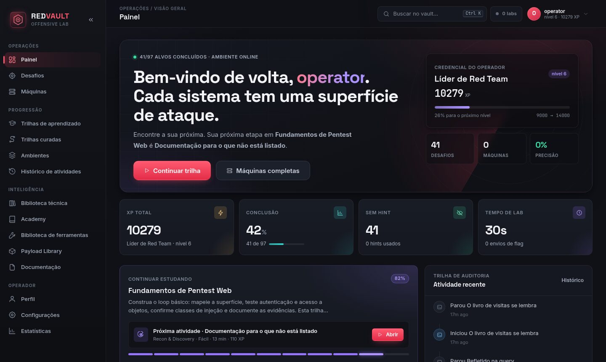
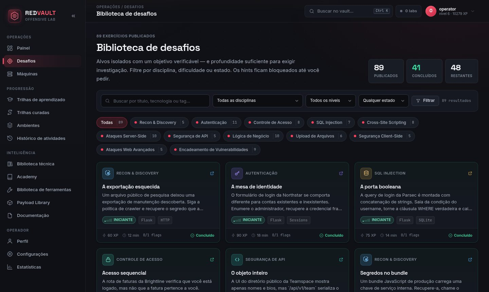
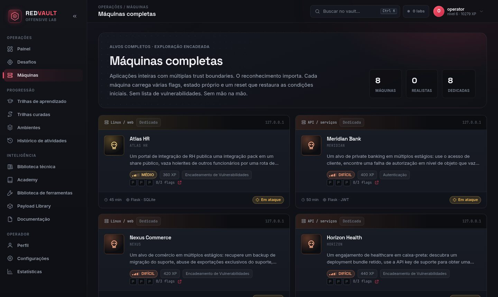
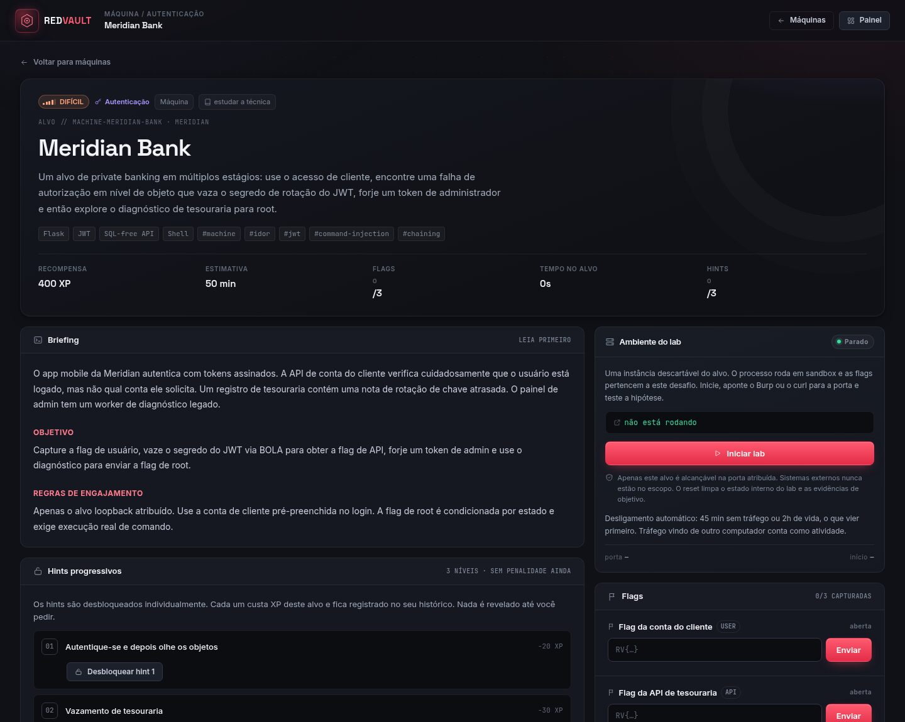
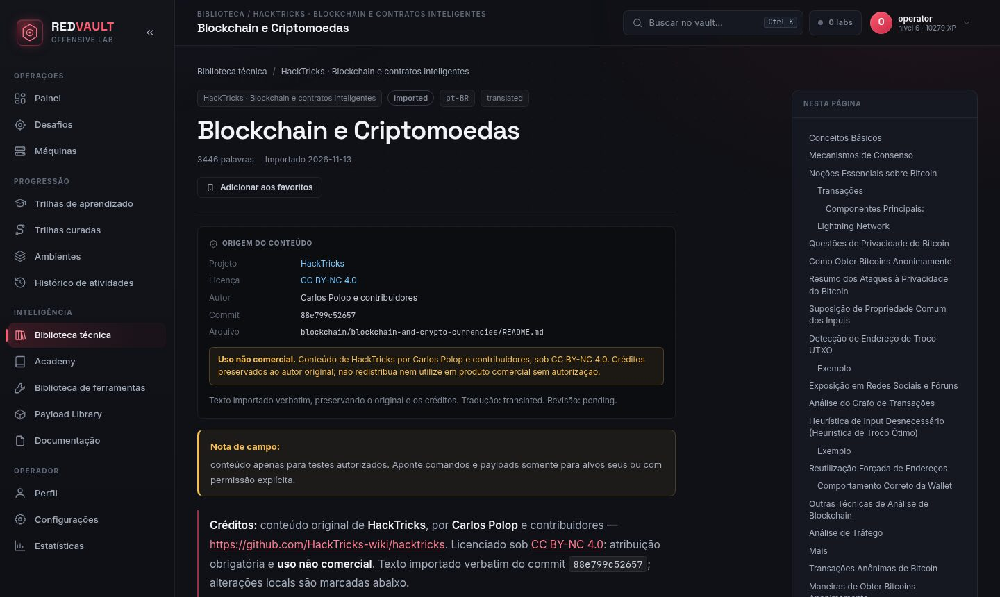
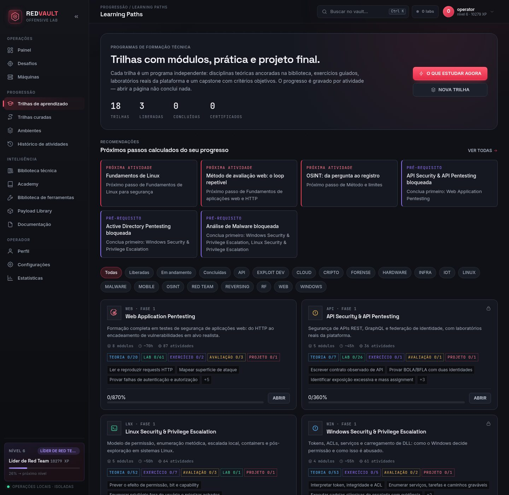
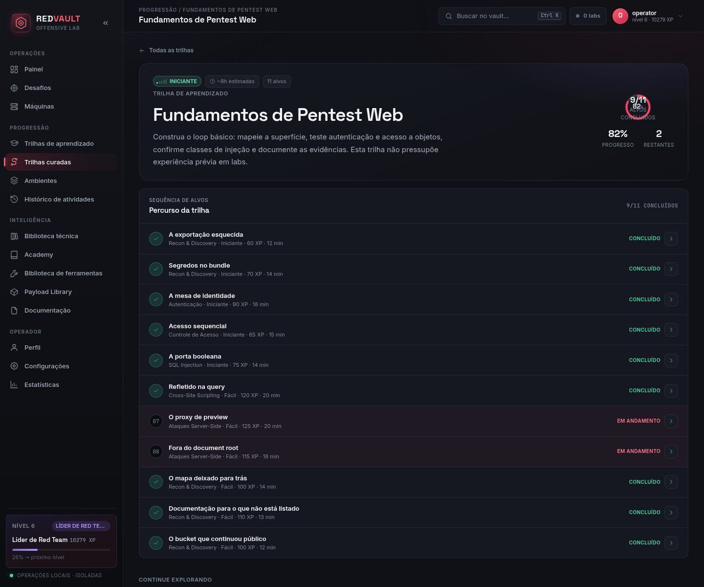

# REDVAULT

**Um laboratório de segurança ofensiva para aprender atacando de verdade.**

[](LICENSE)
[](https://www.python.org/)
[](#como-rodar)
[](#como-tudo-funciona)
[](#como-tudo-funciona)

O REDVAULT é uma plataforma para estudar red team na prática. Você abre o navegador, escolhe um alvo e começa a explorar. São aplicações de verdade, feitas para serem vulneráveis de propósito, rodando na sua própria máquina.

Tudo funciona local, sem login, sem nuvem e sem custo. Você liga a plataforma, escolhe por onde começar e vai.



## Números do projeto

| O que | Quanto |
| --- | ---: |
| Alvos publicados | **97** |
| Desafios | **89** |
| Máquinas completas | **8** |
| Categorias de desafio | **12** |
| Flags | **113** |
| Dicas progressivas | **291** |
| Walkthroughs | **97** |
| Referências | **291** (151 fontes distintas) |
| Documentos na biblioteca | **1.303** |
| Payloads com contexto | **1.716** |
| Programas de trilha | **18** |
| Trilhas curadas | **10** |
| Atividades nas trilhas | **788** |
| Artigos da Academy | **17** |
| Ferramentas catalogadas | **22** |
| Conquistas | **15** |

Todos os números acima foram contados direto do banco de dados e do conteúdo do projeto. A suíte inclui um teste que confere o catálogo com o banco (`tests/test_platform_phase3.py::test_catalog_counts_match_database`).

## Os alvos

O catálogo tem **97 alvos**: **89 desafios** e **8 máquinas**. Os desafios cobrem **12 categorias**: reconhecimento, autenticação, controle de acesso, SQL injection, XSS, ataques server-side, segurança de API, falha de lógica de negócio, upload de arquivos, segurança client-side, ataques web avançados e encadeamento de vulnerabilidades. Cada categoria tem pelo menos 4 labs.

| Dificuldade | Alvos |
| --- | ---: |
| Iniciante | 6 |
| Fácil | 26 |
| Médio | 31 |
| Difícil | 30 |
| Insano | 4 |

As 8 máquinas são cenários maiores, com começo, meio e fim. Cada uma tem três flags, uma de usuário, uma de API e uma de root, e exige encadear várias falhas até o objetivo final.

| Máquina | Categoria | Foco |
| --- | --- | --- |
| Meridian Bank | Autenticação | JWT, IDOR, command injection |
| Nexus Commerce | Encadeamento | acesso a objetos, escalação de privilégio |
| Horizon Health | Encadeamento | avaliação multietapa no estilo healthcare |
| Atlas HR | Encadeamento | portal de RH, invoices, conversor de arquivos |
| Finch Support | Encadeamento | backup de onboarding, BOLA, reset flow |
| Harbor Claims | Encadeamento | portal de seguros, material de migração exposto |
| Orbit Console | Encadeamento | console SaaS, secret JWT vazado, SSRF |
| Wayline Logistics | Encadeamento | docs de API, SSRF, command injection |

Em **57 alvos**, a flag só é aceita depois que o objetivo real é cumprido. O lab precisa registrar um callback de verdade antes de a plataforma validar o valor, então não adianta tentar atalho.





### Como funciona uma sala

Cada alvo tem sua própria página em `/lab/<slug>`, em tela cheia, com briefing, objetivo, regras de engajamento, dicas progressivas, flags e o controle do ambiente. O painel de ambientes cuida do ciclo de vida: iniciar, ver status, resetar, parar, porta, verificação de prontidão e desligamento automático.



## A biblioteca

A biblioteca técnica é a parte que escala o estudo. São **1.303 documentos**, quase **2,5 milhões de palavras**, organizados em **183 categorias**, com busca de texto completo, bloco de procedência em cada página, payloads relacionados e vínculo direto com os labs da plataforma.

| Origem | Conteúdo | Licença |
| --- | --- | --- |
| HackTricks (edição PT-BR) | importado verbatim | CC BY-NC 4.0, só uso não comercial com atribuição |
| PayloadsAllTheThings | 135 documentos, 477 payloads | MIT |
| OWASP WSTG | referência citada | CC BY-SA 4.0 |
| Conteúdo próprio | 24 documentos escritos para o projeto | MIT |

A coleção de **1.716 payloads** cobre **1.060 técnicas** em **64 linguagens**, todos com contexto de uso.



A seleção de fontes é feita no código, não por convenção. O importador recusa qualquer projeto cuja licença não permita a reutilização, copia o texto da licença para `content/kb_licenses/` e guarda o commit de origem em cada documento. O HackTricks só é importado pelo caminho marcado como uso não comercial, e cada página mostra o aviso de atribuição a Carlos Polop.

## As trilhas

Para quem não quer escolher desafio no escuro, existem **18 programas de trilha**, em **78 módulos** e **151 unidades**, com **788 atividades**: 514 de teoria, 138 exercícios, 89 labs, 29 avaliações e 18 projetos finais.

| Fase | Trilhas |
| --- | --- |
| 1 | Web Application Pentesting, API Security, Linux Security, Windows Security |
| 2 | Active Directory, Network Pentesting, Wireless Security, Hardware Hacking |
| 3 | Análise de Malware, Forense Digital, Cloud e Containers, Segurança Mobile, Exploit Development, Engenharia Reversa, Criptografia Aplicada, OSINT, Red Team, IoT e Embarcados |

Cada atividade registra o que precisa fisicamente para ser feita. Das 788, 521 rodam só com software, 14 exigem equipamento de verdade, 4 têm equipamento opcional, 1 é simulação e 248 não declaram exigência. Quando algo exige um bastidor, uma plaquinha ou um rádio, o exercício diz o modelo mínimo, o custo e a alternativa que cobre o mesmo conceito só com software.

Ainda existem **10 trilhas curadas** que organizam os desafios em sequência, do mais simples ao mais avançado, com progresso e certificado interno de conclusão. O certificado é um registro privado de estudos, não uma certificação profissional, e o próprio documento diz isso.





Também fazem parte da plataforma a Academy, com **17 artigos**, um glossário com **27 termos**, uma coleção de **10 CVEs** comentadas e **22 ferramentas** em cinco categorias.

## Como tudo funciona

O REDVAULT foi feito para rodar em uma máquina só, sem complicação. Não tem cadastro, não tem senha e não tem painel administrativo para configurar. A plataforma sobe em **127.0.0.1:8000** e trata você como o operador local.

- **Sem login.** A plataforma é de operador único. A sessão do navegador existe só para carregar o token de CSRF.
- **Labs isolados.** Cada lab roda em processo próprio, em portas locais entre **42000 e 42999**, com sandbox opcional via bubblewrap e limites de recurso com prlimit.
- **Flags assinadas.** As flags são derivadas com HMAC-SHA256 a partir de uma chave local e nunca ficam gravadas no banco nem aparecem na interface.
- **Objetivo verificado.** Nos labs com estado, a plataforma só aceita a flag depois que o lab registra o callback da exploração.
- **Bot real.** Desafios de XSS contam com um navegador Chromium de verdade como vítima, rodando só em loopback.
- **Interface em pt-BR.** Desafios, dicas, walkthroughs, biblioteca e trilhas estão todos em português do Brasil. Termos técnicos consagrados em inglês continuam em inglês.

## Como rodar

Requisitos: Python 3.11 ou mais novo, Linux recomendado. Bubblewrap e prlimit deixam o isolamento mais forte, e Chromium com chromedriver habilita os labs de XSS.

```bash
git clone https://github.com/lunalully/redvault.git
cd redvault

python3 -m venv .venv
. .venv/bin/activate
python3 -m pip install -r requirements.txt

python3 run.py
```

Abra **http://127.0.0.1:8000**. Na primeira execução a plataforma cria o banco e a chave local em `data/`, cadastra o operador e carrega o catálogo. Nada disso vai para o Git.

A biblioteca vem vazia por padrão, porque importar conteúdo de terceiros é uma decisão de quem instala. Para popular:

```bash
git clone --depth 1 --branch pt https://github.com/HackTricks-wiki/hacktricks /tmp/hacktricks-pt
git clone --depth 1 https://github.com/swisskyrepo/PayloadsAllTheThings /tmp/patt

python3 scripts/import_kb.py --source hacktricks --path /tmp/hacktricks-pt --rebuild-index
python3 scripts/import_kb.py --path /tmp/patt --rebuild-index
```

Se você estiver só experimentando e não quiser os labs de XSS, Chromium não é necessário. Os demais labs funcionam sem ele.

## Testes

```bash
python3 run_tests.py                  # a suíte inteira, cada módulo em seu processo
python3 -m pytest tests/test_labs.py -q
```

São **199 testes** em 9 módulos: testes de exploit contra cada lab, testes de plataforma, biblioteca, trilhas, modo LAN e tráfego. Os testes de plataforma usam um banco temporário e não tocam no seu progresso.

## Estrutura do projeto

```text
redvault/
├── app/                  aplicação FastAPI (rotas, API, flags, labs, biblioteca)
│   ├── templates/        interface Jinja2
│   └── static/           CSS, JavaScript e fontes servidas localmente
├── content/              desafios, trilhas, academia, glossário, CVEs, ferramentas
├── labs/                 uma aplicação vulnerável de verdade por alvo
├── scripts/              importadores da biblioteca e geradores de trilha
├── tests/                testes de exploit e de plataforma
├── data/                 banco, chave e estado dos labs (ignorado pelo Git)
├── docs/                 notas de apoio e imagens
└── run.py                launcher
```

Leitura recomendada: [ARCHITECTURE.md](ARCHITECTURE.md) para o desenho da plataforma e [SECURITY.md](SECURITY.md) para o modelo de isolamento e as limitações.

## Segurança e ética

Este projeto existe para estudo. Todo alvo é vulnerável de propósito.

- Use apenas em máquinas que você controla.
- Mantenha a plataforma e as portas dos labs em loopback. Não faça proxy reverso para a internet.
- Não use payloads, scanners ou callbacks do laboratório contra sistemas de terceiros.
- O código dos labs é didático e não deve ser reaproveitado em produção.
- Ao compartilhar os labs na rede local, use só uma rede confiável e pare os labs no fim do exercício.

## Licença

O código deste repositório é distribuído sob a [licença MIT](LICENSE).

Três exceções importantes, porque este repositório também distribui conteúdo de terceiros:

| Caminho | Licença |
| --- | --- |
| `content/kb_licenses/` | textos originais das licenças de HackTricks e PayloadsAllTheThings |
| conteúdo importado em tempo de instalação | mantém a licença da fonte, o HackTricks em CC BY-NC 4.0 |
| `app/static/fonts/` | SIL OFL 1.1, com texto em `app/static/fonts/LICENSE.md` |

Nada de terceiro é redistribuído sob MIT. Se você for usar este projeto comercialmente, o conteúdo do HackTricks fica de fora.

## Autor

Feito por [Luna (lunalully)](https://github.com/lunalully) para estudar e ensinar segurança ofensiva em português.